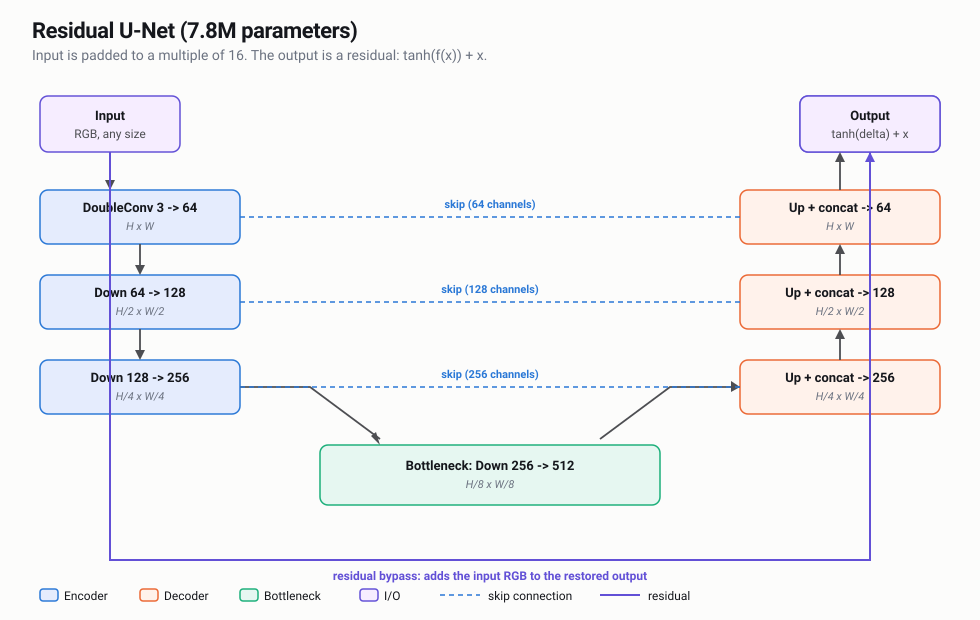
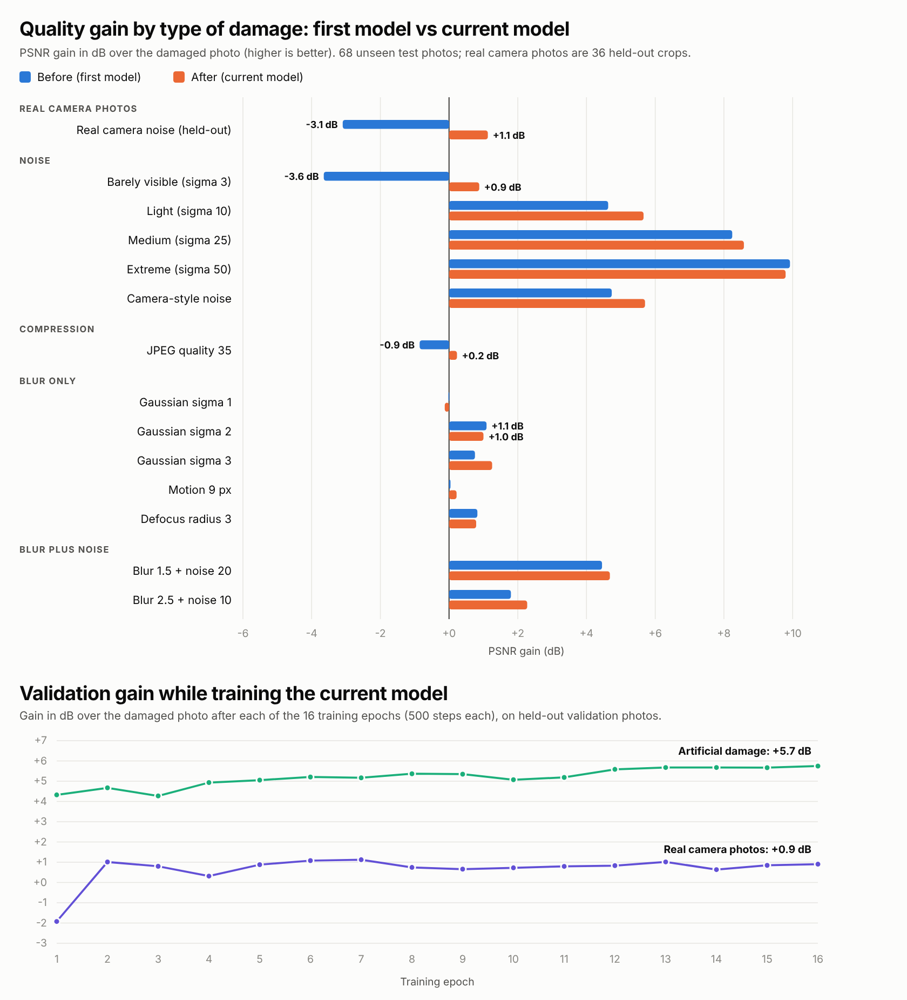
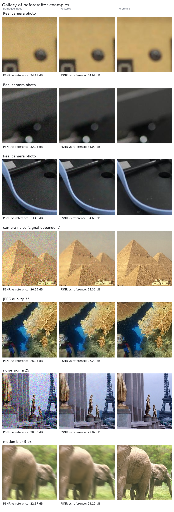

# Documentation

Project write-up and visual results. The main [README](../README.md) in the
project root has installation, deployment and the full results tables.

## Architecture



- A U-Net with three down/up steps and a residual output `tanh(f(x)) + x`, so the
  network only has to learn the damage rather than redraw the photo.
- Bilinear upsampling (no checkerboard artifacts).
- 7.8 million parameters, 16 MB on disk.
- Any input size works: the input is padded to a multiple of 16 internally.

See [`models/unet.py`](../models/unet.py) for the implementation.

## Training

- **Stage 1 (v1):** 60 epochs on 360 BSDS500 photos with one fixed noisy or
  blurred copy each, L1 loss.
- **Stage 2 (v2, current):** 8,000 further steps, about 75 minutes on four CPU
  cores. Photos are damaged freshly every time they are drawn (see
  [`data/degradations.py`](../data/degradations.py)): untouched, noise only,
  blur only, blur plus noise, or JPEG only. Noise strength is log-uniform so
  mild noise is common. Blur covers Gaussian, directional, motion and defocus
  kernels. 30% of each batch is real camera-noise patches from 25 PolyU
  scenes. The loss adds an edge-sharpness term (L1 on Sobel gradients).

### Validation curve



The top chart shows every damage type, before (old model) and after (current
model). The bottom chart is the gain in dB on held-out validation photos after
each of the 16 training epochs. Progress on real camera photos is small because
the input PSNR is already ~37.5 dB and there is little left to recover.

## Gallery



Each row has the damaged input, the restored output and the clean reference.
PSNR numbers are vs. the reference. The first three rows are real camera photos
from scenes the model never saw during training; the rest are synthetic damage
types.

## Results

| | PSNR | SSIM |
|---|---|---|
| Real camera noise, held-out (36 crops) | 35.42 -> **36.54 dB** (+1.13) | 0.85 -> **0.95** |
| Mixed synthetic (68 photos) | 20.62 -> **26.87 dB** (+6.26) | 0.69 -> **0.71** |
| Camera-style noise | 27.92 -> **33.62 dB** (+5.70) | 0.80 -> **0.93** |
| Barely visible noise (sigma 3) | 38.48 -> **39.36 dB** (+0.88) | 0.95 -> **0.98** |
| JPEG quality 35 | 30.29 -> **30.52 dB** (+0.23) | 0.76 -> **0.89** |
| Blur only (sigma 2) | 24.71 -> **25.71 dB** (+1.00) | 0.74 -> **0.72** |

See the main README for every damage type and for the old-model comparison. All
numbers come from `python scripts/evaluate.py --weights weights/unet.pth --real data/real/test`.

## Reproduce the pictures

```bash
python scripts/evaluate.py --weights weights/unet.pth --real data/real/test
python scripts/compare_models.py --weights <old> <new> --names Before After --real data/real/test --out comparison.png
python scripts/make_gallery.py docs/gallery.png
```
